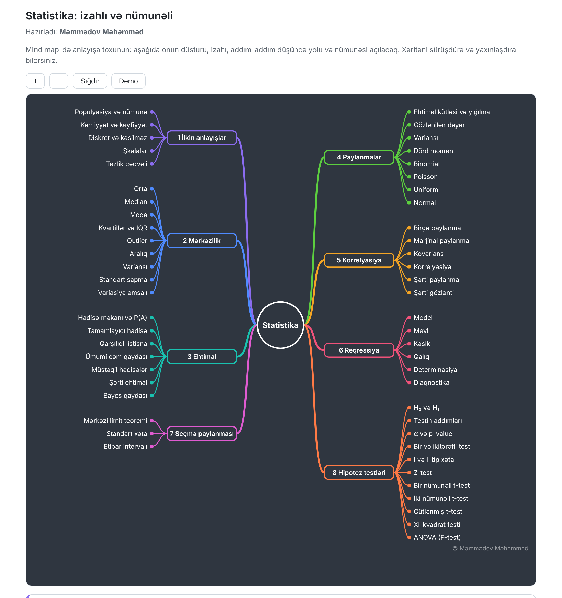
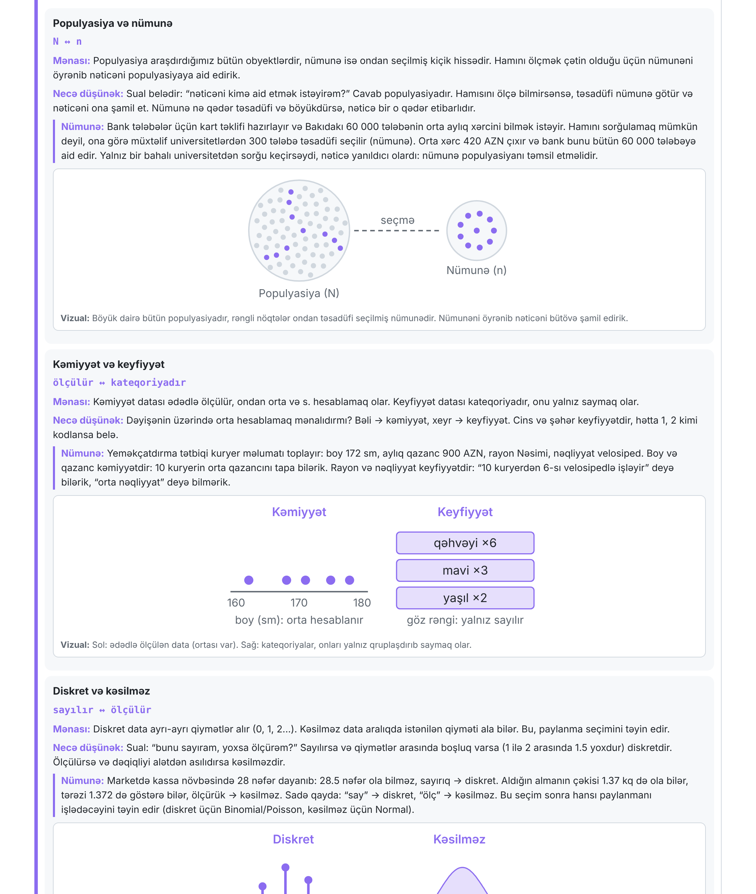

# Statistika Mind Map

🔗 **Canlı versiya:** https://magamodin.github.io/statistika-mind-map/

Statistikanı daha rahat öyrənmək üçün hazırlanmış interaktiv mind map: **8 bölmə, 55 anlayış**.

Hər anlayışın üstünə toxunanda onun **düsturu, izahı, düşüncə yolu və nümunəsi** açılır. Xəritəni sürüşdürmək və yaxınlaşdırmaq olur. **Demo** düyməsi isə təsadüfi anlayışı özü seçib kartını açır. Eyni zamanda kiçik statistika bələdçisi kimi işləyir: ilkin anlayışlardan hipotez testlərinə qədər ardıcıl getmək mümkündür.

## Bölmələr

1. İlkin anlayışlar və data tipləri
2. Mərkəzilik və dəyişiklik
3. Ehtimal nəzəriyyəsinin əsasları
4. Təsadüfi dəyişənlər və paylanmalar
5. Çoxdəyişənli dəyişənlər və korrelyasiya
6. Xətti reqressiya və diaqnostika
7. Seçmə paylanması və etibar intervalı
8. Hipotez testləri

⬇️ **Yüklə:** [Statistika Mind Map (HTML fayl)](https://github.com/magamodin/statistika-mind-map/releases/latest)
Faydalı oldusa, ulduz ⭐ qoya bilərsiniz.
